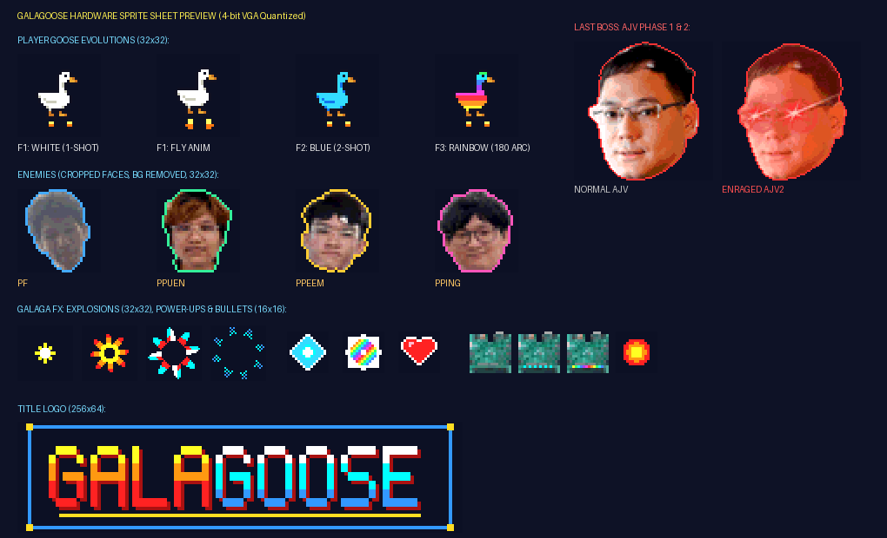
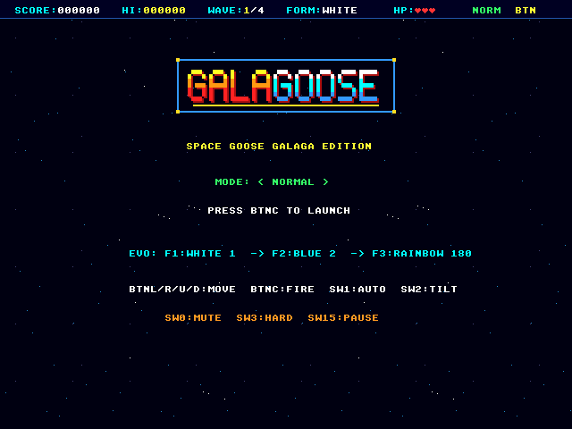
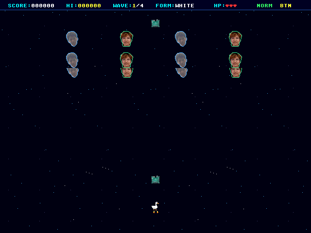
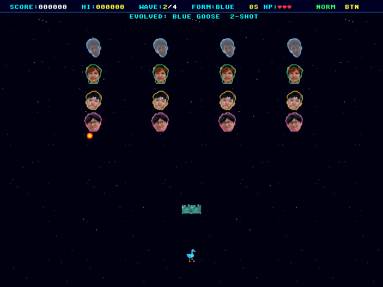
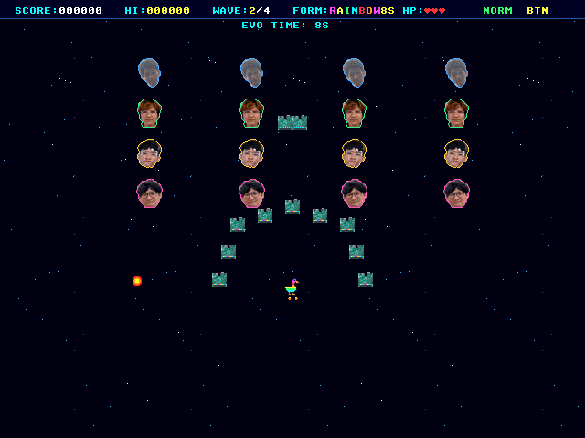
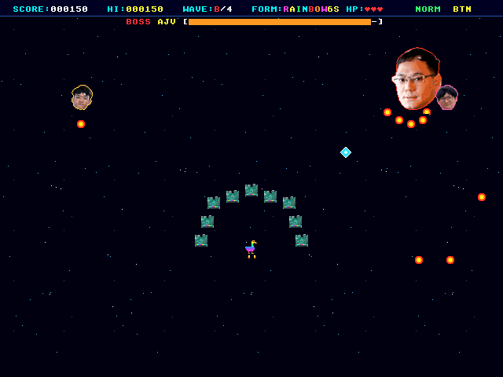
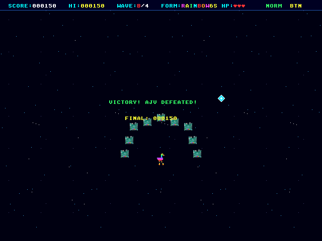

# Galagoose: Space Shooter (Nexys A7 FPGA Edition)
> **Pure Hardware FPGA Arcade Space Shooter Game (No Soft-Core / No CPU)**  
> Developed for **Digilent Nexys A7-100T (Artix-7 XC7A100T-1CSG324C)**  
> Running at **100% Native 60 FPS VGA (640×480 @ 60Hz)** with custom RTL Sprite Engine, Digital MEMS Mic Voice Shield, Dual-Port BRAM HUD, and Hardware Audio Synth.



---

## 🎮 Game Overview

**Galagoose** is an intense, hardware-accelerated retro arcade space shooter running entirely as pure digital logic on a Xilinx Artix-7 FPGA. Players pilot the legendary battle goose through swarms of attacking alien minions, collect power-up orbs to evolve weapons, and face off against the formidable multi-phase boss **AJV** (Normal Face ➔ Enraged Laser-Eyed AJV2). In the climactic final boss battle, players can physically shout into the on-board digital MEMS microphone to deploy a bullet-deflecting kinetic energy barrier!

- **Platform:** Digilent Nexys A7-100T FPGA Board (`xc7a100tcsg324-1`)
- **Pixel Clock:** 100 MHz System Oscillator ➔ 25.0 MHz VGA Pixel Clock
- **Resolution & Frame Rate:** 640×480 @ 60 Hz Progressive VGA (12-bit RGB, 4,096 colors)
- **Architecture:** 100% Pure RTL Hardware Logic (Zero CPU, No MicroBlaze, Zero OS overhead)
- **Sub-FSM Pipeline:** 14 time-multiplexed clock phases per 60 Hz frame for collision, physics, and rendering
- **Audio:** Custom RTL Audio Synthesizer with PWM output, ADSR envelope generation, and chiptune sound effects
- **Sensors & I/O:** ADMP421 Digital MEMS Microphone (PDM demodulator), ADXL362 SPI 3-Axis Accelerometer tilt steering, 8-digit 7-segment display, 16-LED HP bargraph, dual RGB LEDs

---

## 📸 In-Game Screenshots & Previews

| Title Screen & Metallic Banner | Wave 1: Formation Grid & White Goose |
|:---:|:---:|
|  |  |
| **Wave 2: Blue Goose 3-Way Spread (9s Timer)** | **Wave 3: Rainbow Goose 5-Way Piercing Barrage** |
|  |  |
| **Wave 4: Boss AJV & Voice Barrier HUD Gauge** | **Victory Celebration Screen** |
|  |  |

---

## 👹 Boss AJV Multi-Phase Evolution

| Phase 1: Normal Face (HP > 50%) | Phase 2: Enraged Face AJV2 (HP &le; 50%) |
|:---:|:---:|
|  |  |
| *Smooth horizontal hover, 4–5 bullet radial salvos* | *High-speed Feint Weaves, glowing red laser eyes, 7–8 bullet rotating vortex barrages* |

---

## ✨ Key Features & Architecture

### 1. 🦆 3-Tier Goose Evolution & Weapon System
The player's battle goose evolves in real time upon collecting dropped power-up orbs:
- **Form 0 — White Goose (Default):** Precision high-velocity single laser cannon (1 damage).
- **Form 1 — Blue Goose:** Collect a Blue Orb to unlock a **3-way angled spread attack** (-15°, 0°, +15°) lasting for 9.0 seconds. A digital countdown timer tracks the remaining time on the HUD.
- **Form 2 — Rainbow Goose (Ultimate):** Collect a Rainbow Orb while in Blue Goose form to unlock the **5-way piercing rainbow laser cannon**, unleashing devastating high-damage beams that obliterate enemy ranks.

### 2. 🛡️ Voice-Activated Kinetic Barrier (Wave 4 Last Boss)
- Integrated with the Nexys A7's **ADMP421 Digital MEMS Microphone** via a hardware PDM demodulator and moving-window RMS envelope detector.
- In Wave 4, players can **shout into the microphone** to deploy a protective kinetic barrier around the goose for **3.0 seconds**.
- **Bullet Reflection:** Incoming boss bullets colliding with the barrier are reflected, converting into player-owned counter-attack projectiles.
- **Sequential 8.0s Cooldown:** Features a dedicated 8.0-second cooldown timer (11.0s full cycle) paired with a real-time procedural circular recharge gauge on the VGA HUD.

### 3. 🛸 Minion Formation AI & Dive-Bombing Swoops
- 16 autonomous alien minions governed by individual 4-state flight FSMs:
  1. `MODE_ENTER (00)`: Fly in from top of screen into assigned formation slots.
  2. `MODE_FORM (01)`: Sway synchronously in grid formation using sine/triangle wave generation.
  3. `MODE_DIVE (10)`: Break formation to perform high-speed swooping dives aimed directly at player coordinates while firing sniper bullets.
  4. `MODE_RETURN (11)`: Wrap around the bottom edge and navigate back to their home formation slot.

### 4. 💎 Guaranteed Item Drops & Boss Milestones
- **Guaranteed Rainbow Orb:** In Wave 4, as soon as the player enters Blue Goose form, the engine triggers a 2.5–3.0 second countdown that guarantees a Rainbow Orb drop directly in the player's path before the 9.0s timer expires.
- **Milestone Life & Power Drops:** Automatic emergency drops trigger when Boss AJV's HP crosses the 50% and 25% thresholds.

### 5. 🎛️ Multi-Phase Clock Engine (14 Execution Phases)
To completely prevent timing violations on the 25 MHz pixel clock, `game_engine.sv` time-multiplexes physics, collision, and rendering across 14 sequential hardware phases:
```
PH_IDLE ➔ PH_PLAYER ➔ PH_SPAWN_PB ➔ PH_UPD_PB ➔ PH_COL_PB ➔ PH_UPD_EN ➔ 
PH_UPD_BOSS ➔ PH_UPD_EB ➔ PH_UPD_ORB ➔ PH_UPD_EXP ➔ PH_WAVE_CHK ➔ 
PH_INIT_WAVE ➔ PH_HUD_X ➔ PH_BOSS_FIRE
```

---

## 🕹️ Controls & Hardware Peripherals (Nexys A7)

### 1. Slide Switches (`SW[15:0]`) — Hardware Debounced (5ms Filter)
| Switch | Signal Name | Function & Logic State |
|:---|:---|:---|
| **SW[0]** | `sw_mute` | **Audio Mute:** `0` = Sound ON, `1` = Mute all audio output |
| **SW[1]** | `sw_autofire` | **Autofire Mode:** `0` = Manual firing (BTNC), `1` = Continuous rapid laser fire |
| **SW[2]** | `sw_tilt` | **Tilt Steering:** `0` = Button/Keyboard control, `1` = ADXL362 Accelerometer tilt steering enabled |
| **SW[3]** | `sw_hard` | **Difficulty Override:** `0` = Normal Mode (or title menu select), `1` = Force Hard Mode |
| **SW[4]** | `sw_debug` | **Debug Display:** `0` = Normal Game HP/Mic LEDs, `1` = PS/2 Keyboard scan code & debug bitmask on LEDs |
| **SW[5]** | `sw_kbd` | **PS/2 Keyboard Priority:** `0` = Buttons enabled, `1` = Force PS/2 Keyboard control |
| **SW[6]** | `sw_kbd_swap` | **Keyboard Key Swap:** `0` = Default mapping, `1` = Swap Arrow keys vs WASD layout |
| **SW[11:7]** | - | *Unused* |
| **SW[13:12]** | `mic_threshold` | **Microphone Sensitivity Threshold (Voice Barrier):**<br>• `00` = Normal Shout (Threshold 85)<br>• `01` = Sensitive (Threshold 65 - lighter voice activates)<br>• `10` = Louder Shout (Threshold 105)<br>• `11` = Maximum Loudness (Threshold 130 - noisy environment filter) |
| **SW[14]** | `sw_giveup` | **Surrender / Give Up:** Toggle UP (`1`) = Instant Game Over; Toggle DOWN (`0`) at Game Over screen = Quick reset to Title |
| **SW[15]** | `sw_pause` | **Pause Game:** `0` = Normal gameplay, `1` = Pause game and freeze screen |

---

### 2. Push Buttons (D-Pad) — Hardware Debounced (5ms Filter)
| Button | In-Game Action |
|:---|:---|
| **BTNU** | Move Goose Up |
| **BTND** | Move Goose Down |
| **BTNL** | Move Goose Left *(In Title Screen: Select Normal Difficulty)* |
| **BTNR** | Move Goose Right *(In Title Screen: Select Hard Difficulty)* |
| **BTNC** | Fire Primary Laser / Confirm Start in Title Screen / Restart in Game Over or Victory |
| **CPU_RESETN** *(Red Button)* | **Master Hardware Reset** (Active-Low): Re-initializes all registers and returns to Title Screen |

---

### 3. Voice Input (ADMP421 Digital MEMS Microphone)
| Input Mechanism | In-Game Action |
|:---|:---|
| **Physical Shout into Mic** | **Deploy Voice Kinetic Barrier (Wave 4 Last Boss only):**<br>When your shout volume exceeds the selected threshold (`mic_threshold`), the barrier deploys for 3.0 seconds, making the goose invulnerable and reflecting all enemy bullets. Cooldown is 8.0 seconds before the next shout can be used. |

---

### 4. Telemetry Displays (LEDs, RGB LEDs, 7-Segment)

#### 16 Green LEDs (`LED[15:0]`)
- **Waves 1–3:** Real-time **Minion Count Bargraph** (number of LEDs lit corresponds to alive minions).
- **Wave 4 (Boss Stage):**
  - **Upper Byte (`LED[15:8]`):** **Boss AJV Health Bar** (dynamically scaled: 6 HP/LED in Normal mode, 7.5 HP/LED in Hard mode).
  - **Lower Byte (`LED[7:0]`):** **Live Microphone Sound Level Meter** (shows instantaneous vocal energy).
- **When `SW[4] == 1` (Debug Mode):** Displays keyboard link status, scan codes, and input bitmasks.

#### Dual PWM RGB LEDs
- **RGB LED 16 (Goose Evolution Indicator):**
  - **White (`RGB = 111`):** Form 0 (White Goose)
  - **Cyan (`RGB = 011`):** Form 1 (Blue Goose)
  - **Rainbow Cycle:** Form 2 (Rainbow Goose)
- **RGB LED 17 (Combat & Barrier Status Indicator):**
  - **Green (`RGB = 010`):** Barrier Ready to Shout! (in Wave 4)
  - **Cyan (`RGB = 011`):** Barrier Active & Protecting (in Wave 4)
  - **Flash Green:** Stage Clear / Weapon Evolution event
  - **Flash Red:** Player taking damage
  - **Flash Yellow:** Boss incoming alert

#### 8-Digit 7-Segment Display (`AN[7:0]`)
- **AN7:** Current Wave number (`1`, `2`, `3`, or `b` for Boss stage).
- **AN6:** Current Goose Form (`1.` for White, `2.` for Blue, `3.` for Rainbow, with decimal point).
- **AN5..AN0:** 6-digit BCD Score and High Score display.

---

### 5. Alternative Controls (Keyboard & Serial PC Bridge)
- **PS/2 Keyboard (USB Host Port J5):** Plug a standard USB keyboard into J5; control with Arrow Keys / WASD, Space to fire, Enter to start, and Esc to pause.
- **PC Serial Controller Bridge (`scripts/pc_controller.py`):** Control the game using a PC keyboard or USB gamepad over the USB-UART port @ 115,200 baud.

---

## 📁 Repository Structure

```
GalaGoose/
├── rtl/                        # SystemVerilog / Verilog RTL Sources
│   ├── space_shooter_top.sv    # Top-level integration & clock distribution
│   ├── game_engine.sv          # 14-phase state machine, physics, evolution & combat
│   ├── display_renderer.sv     # 60 FPS VGA pipeline, BRAM sprite compositor, HUD
│   ├── vga_sync.v              # VGA timing generator (640x480 @ 60Hz)
│   ├── peripherals.v           # PDM microphone, ADXL362 accelerometer, 7-seg, debounce
│   ├── audio_synth.v           # PWM tone generator, SFX & music sequencer
│   ├── bram_roms.v             # Block RAM ROM wrappers for sprites and assets
│   └── clk_gen.v               # Clock generation module
├── constrs/                    # FPGA Pin Constraints
│   └── nexys_a7_space.xdc      # Nexys A7-100T master pin mapping
├── doc/                        # Documentation & Architecture Specifications
│   ├── Galagoose_Game_Manual.pdf     # Full player manual & hardware guide
│   ├── Galagoose_FSM_Specification.pdf # Detailed FSM transition diagrams & state tables
│   └── screenshots/            # In-game capture screenshots & asset previews
├── mem/                        # Compiled BRAM Hex Memory Files (.mem)
│   ├── goose_rom.mem           # Goose player sprites
│   ├── boss_rom.mem            # Boss AJV normal & enraged 80x80 textures
│   ├── enemy_rom.mem           # Minion alien sprites
│   ├── font_rom.mem            # 8x8 bitmap font ROM
│   └── pal_rom.mem             # 12-bit color palette ROM
├── scripts/                    # Automation & Tooling Scripts
│   ├── generate_assets.py      # Asset processing and .mem generator
│   ├── pc_controller.py        # Serial UART PC controller bridge
│   └── ppm_to_png.py           # Framebuffer capture converter
├── sim/                        # Testbenches & Simulation Verification
│   ├── tb_space_shooter.sv     # Full system simulation testbench
│   └── tb_vga_capture.sv       # Automated VGA framebuffer capture testbench
├── vivado_build/               # Vivado Batch Scripts, Reports & Pre-built Binaries
│   ├── space_shooter.bit       # Pre-compiled FPGA Bitstream
│   ├── space_shooter.bin       # QSPI Flash binary image
│   ├── space_shooter.mcs       # SPI Flash Intel MCS format
│   ├── program_only.tcl        # Instant JTAG bitstream programming script
│   └── detect_and_program_flash.tcl # Automated QSPI Flash burn script
└── README.md                   # Project README
```

---

## 🚀 Building & Programming

### Prerequisites
- **Xilinx Vivado (2020.2 or newer, including 2024.x)**
- **Digilent Nexys A7-100T FPGA board**
- Standard 15-pin VGA cable & monitor (640x480 capable)
- Micro-USB cable for power and programming

### Method 1: Instant FPGA Programming (JTAG)
To load the pre-compiled bitstream directly into FPGA SRAM:
```powershell
vivado -mode batch -source vivado_build/program_only.tcl
```

### Method 2: Permanent QSPI Flash Programming (Auto-Boots on Power-Up)
To burn the game into the Nexys A7's onboard 128 Mbit Spansion/Micron QSPI Flash memory so the game boots instantly upon connecting power:
```powershell
vivado -mode batch -source vivado_build/detect_and_program_flash.tcl
```

### Method 3: Full Synthesis & Implementation from Source
To rebuild the entire design from RTL sources:
```powershell
vivado -mode batch -source vivado_build/build_offline.tcl
```

---

## 🏆 Authors & Acknowledgments

Created with passion for **Computer Engineering (CPE) @ King Mongkut's University of Technology Thonburi (KMUTT)**.

- **Developer:** **zaycheese** ([@Zaycheeseburger](https://github.com/Zaycheeseburger))
- **Special Boss Tribute:** Ajarn_V (AJV)
- **Target Architecture:** Pure RTL Verilog / SystemVerilog on Digilent Nexys A7-100T (Xilinx Artix-7)

*Licensed under the MIT License.*
